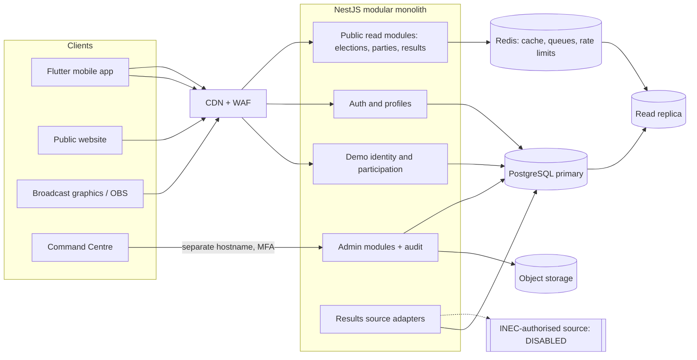
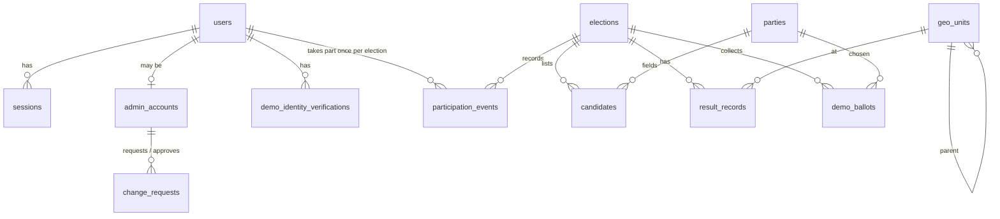

# 9ja Vote — Architecture

Status: Day 1 proposal for project-owner review. Sections marked *implemented* exist in code; the rest is design.

## 1. Scope and boundaries

9ja Vote is an election **information**, results **transparency** and **controlled demonstration** platform.

It does not, and in this codebase cannot:

- accept legally operative votes (no vote endpoint exists; the schema constrains `real_voting_enabled` to false);
- act as a voter register, or imply that an account is voter registration;
- collect fingerprints, face images, identity documents or real NIN/VIN numbers;
- declare a winner, or present synthetic figures as official.

## 2. System overview



One deployable API with clear module boundaries. Public read traffic is cache-first and can be scaled, or split
into its own deployment, without touching admin or auth. No microservices in the first sprint.

The web apps never let the browser call the API host directly: each Next.js server proxies same-origin
`/api/*` to the API (*implemented*). If the API is unreachable the pages render from the bundled synthetic
dataset so the demonstration still works on a poor connection (*implemented*).

## 3. Technology versions

| Layer | Choice | Note |
|---|---|---|
| Runtime | Node.js 22 LTS | |
| API | NestJS 11, TypeScript 5.9 | NestJS 12 is ESM-only and broke the Jest setup, so 11 is pinned for now |
| Web | Next.js 16, React 19 | App Router, server components, system fonts only |
| Mobile | Flutter 3.27+ stable, Dart 3.4+ | Not yet compiled |
| Database | PostgreSQL 17 | |
| Cache and queues | Redis 7, BullMQ (planned) | |
| Tests | Jest 29, Supertest, flutter_test, k6 (planned) | |
| Workspace | npm workspaces | No extra tooling to install; revisit Turborepo if builds get slow |

## 4. Repository structure

```
apps/
  api/          NestJS API (src/health, elections, parties, results, common)
  public-web/   Public site and results dashboard
  admin/        Command Centre
  broadcast/    TV graphics
  mobile/       Flutter app (independently buildable)
packages/
  shared-types/   Domain types, RBAC map, synthetic dataset
  design-system/  tokens.json, styles.css
infrastructure/
  docker/  database/migrations/  deployment/
docs/
  api/  legal/  testing/  DEVLOG.md  OWNER_CHECKLIST.md
infrastructure/ci/github-actions-ci.yml   (copy to .github/workflows/ci.yml)
```

Changes from the proposed layout: `api-client` and `configuration` packages are deferred until there is code
to put in them. Architecture and security documents live at the repository root as requested.

## 5. Data model

Full draft: `infrastructure/database/migrations/0001_init.sql` (not yet executed against PostgreSQL).



Key rules:

- **One participation**: `UNIQUE (election_id, user_id)` on `participation_events`, written in one transaction
  with the ballot insert. A unique `idempotency_key` makes client retries safe. Single-use nonces block replays.
- **Ballot secrecy**: `demo_ballots` has no user column and no link to `participation_events`, and stores only the
  hour of casting. There is deliberately no relationship between those two tables in the diagram above.
- **No silent edits**: `result_records` and `audit_log` are append-only (triggers). A correction is a new version.
- **Maker/checker**: `change_requests.approved_by` must differ from `requested_by`.
- **Results hierarchy**: `geo_units` is a tree: polling unit, ward, LGA, state, national.

## 6. API design

REST, JSON, `/api/v1`. See `docs/api/endpoints.md` for the implemented and planned endpoints.

## 7. Authentication (implemented for administrators)

What runs today, in `apps/api/src/auth`:

- Passwords hashed with **scrypt** (Node built-in, so no native module to compile). Policy: 12+ characters,
  at least one letter and one number, no known-weak prefixes.
- **HS256 tokens** signed with per-type secrets (access 30 min, refresh 7 days). If the operator has not set
  `JWT_ACCESS_SECRET`/`JWT_REFRESH_SECRET`, the API generates ephemeral secrets and warns loudly — sessions then
  end on restart. Secrets are never hardcoded.
- Logout revokes the access token id. Five failed sign-ins lock the account for 15 minutes. Failed attempts are
  audited without revealing whether the email exists.
- **TOTP MFA** (RFC 6238) for administrators: `/auth/mfa/setup` returns a secret and `otpauth://` URL, and MFA
  only switches on after a valid code. Nothing is stored until confirmed.
- The Command Centre keeps the token in an **HttpOnly, SameSite=Lax cookie**; server actions call the API over
  the internal network, so the browser never holds a token in JavaScript.
- **No default accounts exist.** The first administrator is created by `npm run seed:admin`, which prints a
  generated password once, or by another super administrator in the Command Centre.

Still designed but not built: email/SMS verification and recovery, refresh-token rotation with reuse detection,
session listing and revocation per device, new-device alerts, device-keystore storage in the mobile app.

## 8. Authorization (*role map implemented in `shared-types`, shown in the admin app*)

| Role | Can |
|---|---|
| Super administrator | Manage admin accounts, read audit log. Cannot edit data or results |
| Election administrator | Configure elections, approve party changes, publish verified results |
| Data manager | Propose party and candidate edits, ingest results |
| Results verification officer | Verify or dispute results |
| Support officer | Handle support tickets |
| Read-only auditor | Read the audit log |

Nobody both edits and approves, or both ingests and verifies. No permission exposes ballot choices.

## 9. Screen map

**Mobile**: Welcome* → Onboarding → Register / Login / Recovery → Home* → { Elections, Calendar, Parties →
Party → Candidate → Manifesto, Polling unit, Voter education, Identity demo, Eligibility demo, Results,
Notifications, Help } · Profile → { Accessibility, Privacy and security }.  (* = built)

**Public web**: Home* (hero, slideshow, modules, results demo, trust) → Results by level → Parties → Candidates → Calendar → Education.

**Admin**: Overview* → Results verification* (workflow actions) → Audit log* → Administrators* (create, suspend,
change role) → Elections and calendar* → Platform status* → Security settings* (MFA, password).

**Broadcast**: National scoreboard with ticker* → Lower-third overlay (`?mode=lower-third`)*. State comparison
is still planned.

## 10. Infrastructure and running cost (rough, to be re-quoted)

These are order-of-magnitude planning figures, not vendor quotes.

| Stage | Setup | Rough monthly cost |
|---|---|---|
| Demonstration | 1 small API instance, small managed Postgres, small Redis, static web hosting | US$50 to 150 |
| Public pilot | 2 to 3 API instances, HA Postgres + replica, Redis, CDN + WAF, monitoring | US$600 to 1,500 |
| Election-night national traffic | Autoscaled API, larger database, heavy CDN and DDoS protection, 24/7 on-call | US$5,000 to 20,000+ for the peak month |

Also budget for: SMS one-time codes (per message), penetration testing, legal and privacy counsel, Apple and
Google developer accounts, translation.

## 11. Risks and limitations

1. **Legal**: the remote-voting vision is not lawful today according to the brief. Engineering cannot fix that.
2. **Official data**: there is no INEC feed. Without authorisation the platform can only show synthetic data or
   link out to official sources.
3. **Phone biometrics are not accreditation**: they confirm the phone's owner, not a voter.
4. **Duplicate prevention is only as good as the register**: uniqueness here is per platform account.
5. **Ballot secrecy against a database administrator** needs real cryptography (blind signatures or similar) and
   expert review. The table separation here is a demonstration-level control.
6. **Seven days**: enough for a working demonstration, not for certification.
7. **Unverified parts**: the Flutter code has never been compiled; the SQL migration has never been run against
   Postgres; no browser-rendering test has been done (HTTP checks only).
8. **Map**: the state map is a schematic tile grid. A true geographic map needs licensed boundary data.

## 12. Decisions needing owner approval

1. **Persistence**: the API currently uses a JSON document at `apps/api/.data/store.json` — fast to build,
   fine for a demo, not a production database. Recommended next: Drizzle ORM over the existing SQL schema
   (plain SQL migrations, explicit constraints), with repositories behind the current service interfaces.
2. Keep NestJS 11 for now, or move to 12 with an ESM-capable test runner.
3. npm workspaces (current) or pnpm + Turborepo.
4. Product name: repository says 9ja Vote, brief says Nigeria Vote. The code uses 9ja Vote.
5. Use real party names from INEC's published list (with source references) or keep fictional placeholders
   until INEC engagement. Placeholders are the cautious default.
6. Hosting provider and region (a single VPS with the Compose stack is the recommended default; see
   `docs/deployment/README.md`).
7. Keep the AI-generated Aso Rock image for the demo, or supply a licensed photograph now.
8. Whether the public site may run without a sign-in wall in front of the Command Centre — it ships with both
   the app's own sign-in and a Caddy reverse proxy, but admin exposure policy is an owner decision.
9. Email and SMS providers (needed only when notifications leave the demo).
10. Mobile distribution: Google Play only, or iOS as well (iOS needs a Mac and an Apple developer account).

## 13. Seven-day plan

| Day | Work | Exit check |
|---|---|---|
| 1 | Architecture, monorepo, schema draft, scaffolds | Builds and tests pass ✅ |
| 2 | Auth, RBAC, results workflow, audit trail, content, public pages, deployment stack | 23 tests pass ✅ |
| 3 | Demo identity verification, eligibility demo, demo participation records | Synthetic-only checks |
| 4 | Admin change requests (maker/checker) for parties and candidates | Audit trail on every edit |
| 5 | Postgres-backed repositories, Redis cache, load test | Duplicate-attempt tests pass |
| 6 | Security review, accessibility audit, poor-network tests | No critical findings in scope |
| 7 | Android and iOS builds, production deployment, release review | Owner sign-off |


## 14. Implementation status (Day 2)

| Area | State | Notes |
|---|---|---|
| API | Live | 30+ routes, 23 tests, Swagger, throttling, classification header |
| Auth and RBAC | Live | scrypt, HS256, TOTP, lockout, six roles enforced by guards |
| Results workflow | Live | Seven statuses, server-side transition graph, append-only audit entries |
| Persistence | Demo-grade | JSON store at `apps/api/.data/store.json`; Postgres schema drafted, not wired |
| Public web | Live | 12 routes including calendar, parties, education, polling units, drill-down |
| Command Centre | Live | Sign-in, MFA, queue, audit, accounts, platform status |
| Broadcast | Live | Scoreboard, ticker, lower-third overlay |
| Mobile | Written, uncompiled | 8 screens, bundled demo content, no network calls |
| Deployment | Ready, untested | Dockerfiles ×4, Compose prod, Caddy TLS, runbook |
| `packages/api-client`, `packages/configuration` | Deferred | Both apps have small typed fetch helpers instead; a shared client is only worth adding when the mobile app consumes the API |
